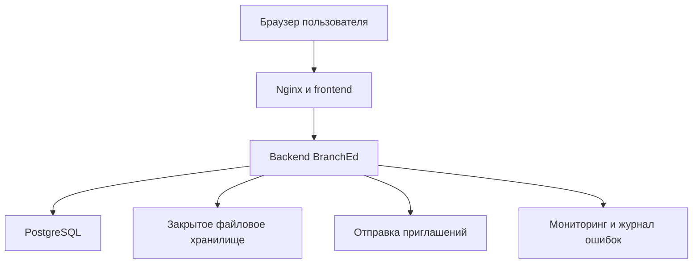

# Идеи для стартапа

| Фамилия Имя | Роль |
| --- | --- |
| Стасенко Илья | Аналитик / Дизайнер |
| Пивоваров Сашуля | Маркетолог / Дизайнер |
| Кондрашин Илья | Тимлид |
| Шиндяпкин Михаил | Программист |

## Курс 4 Симестр 1

## Тема "Разработка веб-системы автоматизированного оформления научных работ на основе заданных стилевых параметров"

### Название

**BranchEd**

# Практические занятия №20–21

## Публикация продукта

### Цель работы

Подготовить стратегию первого релиза BranchEd, объединяющую развёртывание веб-приложения, проверку качества, оформление лендинга, продвижение и сбор обратной связи.

## 1. Общая характеристика проекта

**BranchEd** — веб-система подготовки и автоматического оформления учебных и научных работ по заданным стилевым параметрам. Сервис помогает студентам сосредоточиться на содержании документа, а преподавателям — работать с его структурой и оформлением.

Основной сценарий первого релиза: пользователь регистрируется, создаёт документ, выбирает профиль оформления, применяет его и скачивает результат. Проверка выбранного профиля проводится по конкретным требованиям, поэтому продукт не позиционируется как универсальная гарантия соответствия всем стандартам и методическим указаниям.

| Параметр | Решение для первого запуска |
| --- | --- |
| Формат продукта | Веб-приложение, доступное через браузер |
| Основная аудитория | Студенты, готовящие курсовые и выпускные работы |
| Дополнительная аудитория | Научные руководители и преподаватели |
| Стратегия | Закрытая бета, затем ограниченный публичный запуск |
| Первая группа | 20–30 добровольных участников из учебных групп |
| Главное целевое действие | Создание и успешный экспорт первого документа |
| Коммуникационный CTA | «Присоединиться к бета-тестированию» |
| Позиционирование | «Пиши. Мы оформим.» |

> План относится к подготовке релиза. Выбранные сервисы, сроки и показатели — проектные решения; фактическая публикация продукта и результаты тестирования здесь не заявляются.

### Состав MVP

Для допуска к первому релизу необходимы регистрация и вход, создание и сохранение документа, выбор и применение профиля оформления, экспорт в DOCX и PDF, а также форма сообщения об ошибке. История версий и совместная работа входят в направление развития продукта; в анонсе первого релиза они указываются только после проверки готовности.

Публичный запуск откладывается, если не работает хотя бы один основной сценарий, обнаружена потеря документа или возможен доступ к чужой работе.

## 2. План публикации продукта

### Последовательность запуска

День **D** — день открытия доступа первой тестовой группе. Сроки указаны относительно него, чтобы техническая готовность определяла дату публикации.

| Срок | Действие | Ответственный | Проверяемый результат |
| --- | --- | --- | --- |
| D−14…D−12 | Зафиксировать состав MVP и ограничения беты | Кондрашин Илья, Стасенко Илья | Список функций и критерии допуска |
| D−12…D−10 | Подготовить тестовую среду и сборку | Шиндяпкин Михаил | Сборка развёрнута в staging, версия зафиксирована |
| D−10…D−8 | Настроить сервер, БД, файловое хранилище, домен и HTTPS | Шиндяпкин Михаил | Проверены соединения, сертификат и разграничение доступа |
| D−8…D−6 | Проверить регистрацию, сохранение, оформление и экспорт | Стасенко Илья, Шиндяпкин Михаил | Протокол проверок и исправление блокирующих ошибок |
| D−7…D−5 | Настроить аналитику, журнал ошибок и форму обратной связи | Шиндяпкин Михаил, Пивоваров Александр | Тестовые события и обращения поступают без содержимого документов |
| D−6…D−4 | Подготовить лендинг, демонстрационные материалы и пользовательские документы | Стасенко Илья, Пивоваров Александр | Опубликованный на тестовом адресе лендинг и согласованные тексты |
| D−4…D−3 | Проверить резервное копирование и восстановление | Шиндяпкин Михаил | Тестовая копия восстановлена в отдельной среде |
| D−3…D−2 | Провести пробный деплой и откат | Шиндяпкин Михаил, Кондрашин Илья | Предыдущая версия возвращается без потери совместимости данных |
| D−2…D−1 | Собрать первую группу и отправить приглашения согласившимся участникам | Пивоваров Александр | 20–30 подтверждённых участников и инструкция |
| D−1 | Принять решение о допуске релиза | Кондрашин Илья и команда | Подтверждены все критерии готовности |
| D | Развернуть проверенную версию и открыть доступ тестовой группе | Шиндяпкин Михаил | Пройдена контрольная проверка в production |
| D…D+3 | Наблюдать за ошибками и помогать первым пользователям | Вся команда | Зарегистрированные обращения и исправления критических проблем |
| D+4…D+7 | Проанализировать воронку, провести короткие интервью | Стасенко Илья, Пивоваров Александр | Список проблем с приоритетами |
| D+7 | Решить, готова ли бета к расширению аудитории | Кондрашин Илья и команда | Решение о расширении либо план исправлений |
| D+8…D+14 | При положительном решении разместить публичный анонс | Пивоваров Александр | Публикации с отдельными UTM-метками |

### Порядок технического релиза

1. Зафиксировать релизную версию исходного кода и неизменяемые образы приложения.
2. Собрать приложение и выполнить автоматизированные проверки в CI.
3. Развернуть эту же сборку в staging и проверить её на демонстрационных документах.
4. Проверить совместимость миграций с текущей и предыдущей версиями приложения.
5. Сделать резервную копию данных перед изменениями и убедиться в наличии рабочего способа восстановления.
6. После одобрения тимлида развернуть сборку в production. Секреты передавать из защищённого хранилища, а не из репозитория.
7. Проверить вход, создание документа, применение профиля, сохранение и оба формата экспорта.
8. Открыть доступ пользователям только после контрольной проверки; наблюдать за ошибками и ресурсами сервера.

### Проверки перед открытием доступа

| Проверка | Условие допуска |
| --- | --- |
| Регистрация и вход | Успешный вход, выход и восстановление доступа; корректная обработка неверных данных |
| Сохранение | Текст сохраняется и восстанавливается после повторного входа |
| Права доступа | Один пользователь не может прочитать, изменить или экспортировать чужой документ |
| Оформление | На трёх эталонных документах применяются согласованные шрифты, поля, интервалы и заголовки |
| Экспорт | DOCX открывается в Word/LibreOffice, PDF — в браузере; текст и порядок разделов сохранены |
| Основные браузеры | Ключевой сценарий проходит в актуальных Chrome, Edge, Firefox и Safari |
| Лендинг | Содержимое читаемо на телефоне и компьютере; CTA ведёт в действующую форму |
| Нагрузка | Плановая проверка на 30 одновременных сессиях без потери данных; результаты фиксируются до релиза |
| Аналитика | Тестовые события появляются, повторное обновление страницы не дублирует успешную активацию |
| Восстановление | Выполнено пробное восстановление БД и связанных файлов |

Ошибки безопасности, потеря данных и отказ основного сценария считаются блокирующими. Незначительные визуальные дефекты допускаются только при наличии задачи и срока исправления.

### Откат и действия при сбое

При обнаружении доступа к чужим документам или потери данных доступ к затронутой функции немедленно ограничивается. Тимлид останавливает продвижение, разработчик сохраняет диагностические данные без лишних персональных сведений, а маркетолог размещает краткое уведомление о недоступности.

Если схема данных совместима, возвращается предыдущий проверенный образ приложения. При несовместимой миграции применяется заранее проверенный план восстановления или исправление вперёд. База не восстанавливается поверх новых пользовательских изменений без оценки потерь и согласованного решения. После устранения причины повторно проверяются ключевые сценарии, затем открывается доступ.

### Каналы продвижения

| Канал | Формат | Задача | Ответственный |
| --- | --- | --- | --- |
| Учебные группы | Сообщение с разрешения администратора | Набор первой группы студентов | Пивоваров Александр |
| Преподаватели | Персональное приглашение и короткая демонстрация | Проверка полезности профилей оформления | Стасенко Илья |
| Telegram проекта | Анонс, инструкция, обновления | Поддержка участников и повторные посещения | Пивоваров Александр |
| Email | Приглашение и одно напоминание по согласию адресата | Возвращение участников к первому документу | Пивоваров Александр |
| Профильная публикация | Пост с примером «до/после» | Расширение аудитории после стабильной беты | Пивоваров Александр, Стасенко Илья |

Платное продвижение рассматривается после проверки активации и стабильности продукта. Для первой волны достаточно адресных приглашений и студенческих сообществ. Массовые рассылки по собранным без согласия контактам не используются.

## 3. Подготовка упаковки продукта

### Структура лендинга

| Блок | Содержание | Действие посетителя |
| --- | --- | --- |
| Первый экран | BranchEd, слоган, краткое описание и отметка «Бета-версия» | Нажать «Присоединиться к бета-тестированию» |
| Проблема | Ручная настройка полей, шрифтов и заголовков отвлекает от текста | Узнать свою задачу |
| Решение | Применение выбранного профиля оформления к документу | Понять принцип работы |
| Преимущества | Единые параметры, сохранение структуры, экспорт | Оценить полезность |
| Как это работает | Создать документ → выбрать профиль → проверить → экспортировать | Ознакомиться с основным сценарием |
| Демонстрация | Три скриншота: редактор, профиль оформления, результат экспорта | Посмотреть интерфейс и результат |
| Условия беты | Что доступно, какие ограничения есть и куда писать | Принять осознанное решение об участии |
| FAQ | Собственные требования, проверка результата и работа с данными | Снять основные вопросы |
| Повторный CTA | Короткая форма заявки | Оставить заявку |
| Подвал | Контакты поддержки, политика обработки данных и условия использования | Получить правовую и контактную информацию |

### Тексты первого экрана

**Название:** BranchEd.

**Заголовок:** Пиши. Мы оформим.

**Описание:** Готовьте курсовые и дипломные работы в одном веб-сервисе. Выбирайте профиль оформления, применяйте его к документу и скачивайте результат в DOCX или PDF.

**Основной CTA:** Присоединиться к бета-тестированию.

**Дополнительное действие:** Посмотреть, как работает BranchEd.

**Подпись под кнопкой:** Первый доступ — для небольшой группы студентов. Мы собираем обратную связь и постепенно улучшаем сервис.

### Преимущества

- **Меньше ручных настроек.** Параметры оформления задаются в одном профиле.
- **Единый вид документа.** Шрифты, интервалы и заголовки применяются последовательно.
- **Внимание к содержанию.** Можно работать над текстом и затем проверить результат оформления.
- **Привычные форматы.** Работа экспортируется в DOCX и PDF для дальнейшей проверки и сдачи.

### Демонстрационные скриншоты

В структуре лендинга предусмотрена галерея из трёх реальных снимков релизной сборки. До подготовки снимков ниже зафиксированы их композиция и подписи; они не выдаются за готовые изображения работающего приложения.

| Снимок | Что показать | Подпись и альтернативный текст | Подготовка |
| --- | --- | --- | --- |
| 1. Редактор документа | Учебный текст «Демонстрационная курсовая работа», оглавление и область редактирования | «Создайте документ и сосредоточьтесь на тексте» | Стасенко Илья делает снимок проверенного редактора |
| 2. Профиль оформления | Выбор профиля и параметры шрифта, полей, интервалов и заголовков | «Примените выбранные требования оформления» | Стасенко Илья фиксирует параметры, подтверждённые тестированием |
| 3. Готовый результат | Один фрагмент до и после оформления, затем экспортированный документ | «Проверьте результат и скачайте DOCX или PDF» | Шиндяпкин Михаил проверяет экспорт, дизайнер готовит снимок |

Для галереи используются вымышленные учебные материалы без ФИО, email и реальных научных работ. Снимки должны читаться на экране телефона; подписи остаются обычным текстом страницы. Изображения добавляются в лендинг на этапе D−6…D−4 и являются условием его готовности к анонсу.

### Форма заявки

Обязательное поле — email для приглашения. Роль «студент / преподаватель» необязательна и помогает распределить участников. После отправки показывается сообщение: «Заявка принята. Приглашение придёт на указанную почту».

Форма содержит ссылку на политику обработки данных и необходимые отдельные согласия; подписка на новости не включается автоматически. Валидация сообщает об ошибке рядом с полем. Повторная заявка не создаёт несколько приглашений. Пока сборка закрыта, кнопка не обещает немедленный доступ в приложение.

### Ответы на частые вопросы

**Гарантирует ли сервис соответствие требованиям кафедры?**  
Результат нужно проверить по методическим указаниям. BranchEd применяет выбранный профиль, но требования разных кафедр могут отличаться.

**Можно ли использовать свои параметры?**  
В бете используются проверенные профили. Потребность в собственных параметрах фиксируется через форму обратной связи; доступные настройки перечисляются в интерфейсе.

**Что делать, если экспорт отличается от редактора?**  
Сообщить об ошибке через встроенную форму, указав формат экспорта и описание проблемы. Отправлять полный текст личной работы для обращения не требуется.

**Доступна ли совместная работа?**  
Возможности совместной работы публикуются в списке функций конкретной версии после проверки готовности.

### Текст анонса

> **BranchEd — пиши, а оформление оставь сервису.**
>
> Готовишь курсовую или диплом и снова настраиваешь поля, интервалы и заголовки вручную? Мы готовим бета-запуск BranchEd — веб-сервиса для подготовки и оформления учебных работ.
>
> В первой версии можно будет создать документ, применить профиль оформления и скачать результат в DOCX или PDF. Соответствие требованиям своей кафедры нужно проверить перед сдачей.
>
> Приглашаем студентов и преподавателей в небольшую тестовую группу. Нам важно понять, где сервис помогает, а где остаются неудобства.
>
> **Присоединиться к бета-тестированию — через форму на лендинге BranchEd.**
>
> Будем рады замечаниям об интерфейсе, оформлении и экспорте.

Перед размещением анонса к нему добавляется фактическая ссылка на лендинг с UTM-меткой канала. Адрес не подставляется до регистрации домена и проверки страницы.

### Текст приглашения по email

**Тема:** Приглашение в бета-тестирование BranchEd.

Здравствуйте! Вы оставляли заявку на тестирование BranchEd — сервиса подготовки и оформления учебных работ. Приглашаем попробовать первую версию: создать небольшой демонстрационный документ, выбрать профиль оформления и проверить экспорт в DOCX или PDF.

Для входа используйте персональную ссылку из приглашения. Если возникнет проблема, откройте форму обратной связи в приложении. Нам особенно полезно узнать, удалось ли пройти весь сценарий и где возникли затруднения.

Спасибо за участие! Команда BranchEd.

## 4. Инфраструктура релиза

### Выбор размещения и инструментов

Для первого запуска предлагается размещение в **Yandex Cloud** с выбором ресурсов в России. План не предполагает смену существующего языка программирования или фреймворка: приложение упаковывается в контейнеры в текущем стеке проекта. Публикация в мобильных магазинах на этом этапе не требуется, поскольку продукт является веб-приложением.

| Компонент | Инструмент | Назначение и обоснование |
| --- | --- | --- |
| Сервер приложения | Yandex Compute Cloud | Виртуальная машина для контейнеров приложения; понятная эксплуатация для небольшой беты |
| Веб-сервер | Nginx | Выдача frontend, HTTPS и проксирование запросов к backend |
| Сборка и доставка | GitHub Actions и Container Registry | Проверяемая сборка из конкретной версии кода и доставка неизменяемого образа |
| Развёртывание | Docker Compose | Достаточно для небольшого MVP; оркестрация Kubernetes на первом этапе не требуется |
| База данных | Yandex Managed Service for PostgreSQL | Аккаунты, метаданные документов, профили и обращения; управляемые резервные копии |
| Хранилище файлов | Yandex Object Storage | Закрытое хранение документов и результатов экспорта отдельно от сервера приложения |
| Домен и DNS | Регистратор домена и Cloud DNS | Управление записями и адресом приложения; доступность названия проверяется до регистрации |
| HTTPS | Сертификат доверенного удостоверяющего центра | Защита трафика и автоматическое продление сертификата |
| Секреты | Yandex Lockbox | Пароли БД, ключи сервисов и другие секреты вне исходного кода |
| Аналитика лендинга | Яндекс Метрика | Источники переходов и целевые события заявки; счётчик не устанавливается в редактор документов |
| Продуктовые события | Backend и PostgreSQL | Успешное создание и экспорт фиксируются сервером без передачи текста работы сторонней аналитике |
| Обратная связь | Форма внутри приложения и таблица обращений в PostgreSQL | Связь ошибки с версией приложения и управляемый доступ команды |
| Мониторинг | Yandex Monitoring и Cloud Logging | Состояние сервера, ошибки, длительность экспорта и уведомления |
| Приглашения | Yandex Cloud Postbox | Транзакционные письма; перед запуском проверяются домен отправителя, SPF, DKIM и доставка |

Выбор сделан в пользу одного основного облачного провайдера, чтобы сократить число интеграций и упростить управление доступами. Управляемая БД требует отдельного бюджета, зато уменьшает объём ручного обслуживания. Одной VM достаточно для ограниченной беты, но она остаётся единой точкой отказа приложения; автоматическое масштабирование и высокая доступность не заявляются.

### Схема взаимодействия компонентов

Backend проверяет права доступа при каждом обращении к документу. Файлы передаются через контролируемый сервером механизм, а временные ссылки имеют ограниченный срок действия. База данных не доступна напрямую из интернета.

### Среды и доступы

- **Staging:** отдельная тестовая БД и демонстрационные документы; реальные работы пользователей туда не копируются.
- **Production:** среда участников беты с отдельными секретами и минимальными правами сервисных аккаунтов.
- Доступ команды — через персональные учётные записи с двухфакторной аутентификацией. Общие пароли не используются.
- В логах не сохраняются тексты документов, пароли, токены и полные ссылки восстановления доступа.
- Экспорт ограничивается по размеру входных данных, времени выполнения и числу параллельных задач, чтобы одна работа не блокировала сервер.
- Перед запуском определяются сроки хранения документов, обращений и резервных копий; механизм удаления проверяется отдельно.

### Резервное копирование

Для PostgreSQL настраивается политика резервирования с возможностью восстановления в доступном сервису интервале. Для файлов используются версионирование и отдельные резервные копии с ограниченным доступом. Копии БД и файлов должны позволять восстановить согласованное состояние документа.

Плановые цели для беты: **RPO до 24 часов** — допустимая потеря последних изменений при аварии; **RTO до 4 часов** — целевое время восстановления. Это внутренние цели, а не подтверждённая гарантия. Они проверяются пробным восстановлением; при неудовлетворительном результате запуск переносится либо пересматривается конфигурация. Отдельная копия вне основной площадки снижает зависимость от отказа одного провайдера.

### Планирование расходов

Для закрытой беты устанавливается внутренний лимит инфраструктурных расходов **20 000 ₽ в месяц**. Это бюджет команды, а не тариф провайдера. До заказа ресурсов рассчитывается конфигурация в калькуляторе с учётом VM, БД, файлов, резервных копий, исходящего трафика, журналов и писем.

Ответственный — Кондрашин Илья. Уведомления о расходах настраиваются на 50%, 80% и 100% лимита. Если расчёт выходит за пределы бюджета, сначала сокращаются необязательные ресурсы или размер беты; резервирование и контроль доступа не отключаются ради экономии. Платные сервисы по настоящему плану ещё не заказаны.

## 5. Аналитика и сбор обратной связи

### События воронки

| Этап | Событие | Источник | Что измеряется |
| --- | --- | --- | --- |
| Просмотр лендинга | `landing_view` | Метрика на публичной странице | Посещения по источникам |
| Нажатие CTA | `beta_cta_click` | Метрика | Интерес к участию |
| Принятая заявка | `beta_request_success` | Backend; цель лендинга после подтверждения | Уникальные валидные заявки |
| Регистрация | `signup_success` | Backend | Аккаунты приглашённых участников |
| Первый документ | `document_created` | Backend | Пользователи, создавшие документ |
| Успешный экспорт | `export_success` | Backend | Пользователи, получившие готовый файл |
| Обращение | `feedback_submitted` | Backend | Количество и характер затруднений |

Внешняя аналитика получает только разрешённые технические события лендинга и параметры рекламного источника. Содержимое форм, email, названия документов и их текст в параметры аналитики не включаются. Вебвизор и запись содержимого редактора отключены. Использование аналитики отражается в пользовательских документах и механизме согласий там, где это необходимо.

### Плановые показатели первой недели

| Показатель | Расчёт | Плановая цель |
| --- | --- | --- |
| Набор первой группы | Подтверждённые участники | 20–30 человек |
| Активация | Пользователи с первым успешным экспортом / зарегистрированные участники × 100% | Не менее 50% |
| Успешность экспорта | Успешные завершения / все завершённые попытки экспорта × 100% | Не менее 95% |
| Качественная обратная связь | Короткие интервью по основному сценарию | Не менее 5 интервью |
| Ответ поддержки | Время до первого ответа в рабочее время команды | Не более 1 рабочего дня |
| Критические дефекты | Нерешённые проблемы доступа и сохранности документов | 0 перед расширением беты |

События активации считаются по уникальным участникам. Для экспортов учитываются и успехи, и ошибки, а повторные попытки входят в знаменатель. На маленькой выборке команда рассматривает абсолютные числа вместе с процентами и не делает вывод о рыночном спросе только по конверсии.

### Обработка обращений

Форма содержит категорию проблемы, описание, версию приложения и необязательный контакт для ответа. Прикладывать научную работу целиком не требуется. Для каждого обращения фиксируются дата, приоритет, ответственный и статус.

| Приоритет | Пример | Действие |
| --- | --- | --- |
| Критический | Потеря документа или доступ к чужой работе | Немедленное ограничение функции и остановка расширения беты |
| Высокий | Не работает экспорт или сохранение | Приоритетное исправление и повторная проверка |
| Средний | Сложно найти настройку или непонятен текст ошибки | Задача на ближайшее улучшение интерфейса |
| Низкий | Косметическое замечание | Плановое исправление |

Стасенко Илья группирует обращения, Шиндяпкин Михаил оценивает технические причины, Кондрашин Илья определяет приоритеты, Пивоваров Александр сообщает участникам о статусе и обновлениях.

## 6. Распределение ответственности и риски

| Участник | Зона ответственности | Результат перед запуском |
| --- | --- | --- |
| Кондрашин Илья | Состав релиза, бюджет и решение о запуске | Утверждённый план и допуск релиза |
| Шиндяпкин Михаил | Инфраструктура, сборка, деплой, данные и мониторинг | Проверенная сборка и сценарий восстановления |
| Стасенко Илья | Тестирование сценариев, демонстрации и анализ отзывов | Протокол проверок и материалы интерфейса |
| Пивоваров Александр | Лендинг, анонсы, набор участников и коммуникации | Готовые тексты, форма заявки и приглашения |

| Риск | Мера снижения |
| --- | --- |
| Анонс выходит раньше готовности приложения | Продвижение начинается после допуска релиза и контрольной проверки |
| Обещаны ещё не реализованные функции | Публичный список соответствует проверенной версии MVP |
| Файл после экспорта отличается от ожидаемого | Эталонные документы и проверка DOCX/PDF перед публикацией |
| Участник получает доступ к чужой работе | Серверная проверка прав и отдельные отрицательные тесты |
| Сбой VM, БД или файлового хранилища | Резервирование, мониторинг и пробное восстановление |
| Неожиданный рост расходов | Бюджетные уведомления и ограничение размера беты |
| Переходы есть, но пользователи не экспортируют документ | Анализ воронки и интервью по месту затруднения |
| Пользовательские данные попадают в аналитику | Счётчик только на лендинге, запрет передачи содержимого документов |
| Приглашения попадают в спам | Проверка домена отправителя и тест доставки до рассылки |

## 7. Итог

Для BranchEd выбрана стратегия поэтапного запуска веб-приложения: подготовка проверенной сборки, закрытая бета на 20–30 участников, анализ результатов и затем расширение аудитории. Подготовлены план публикации, структура лендинга, тексты CTA, анонса и приглашения. Определены содержание демонстрационных снимков, инфраструктура, события аналитики, порядок работы с обращениями и обязанности команды.

До фактического запуска необходимо развернуть и проверить приложение, зарегистрировать выбранный домен, подготовить реальные скриншоты и пройти критерии допуска. Успех первой публикации оценивается по прохождению основного сценария и качеству обратной связи, а не только по числу переходов на лендинг.

## 8. Источники

- [Yandex Cloud — резервные копии PostgreSQL](https://yandex.cloud/ru/docs/managed-postgresql/concepts/backup).
- [Yandex Cloud — операции с Managed Service for PostgreSQL](https://yandex.cloud/ru/docs/managed-postgresql/operations/).
- [Яндекс Метрика — цели JavaScript](https://yandex.ru/support/metrica/en/general/goal-js-event).
- [Яндекс Метрика — настройка записи сеансов](https://www.yandex.ru/support/metrica/en/webvisor/settings).
- Практические занятия №20–21 «Публикация продукта»: план публикации, подготовка упаковки и инфраструктура релиза.
